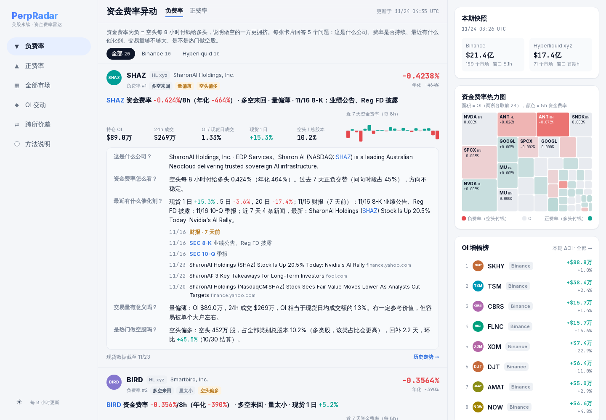
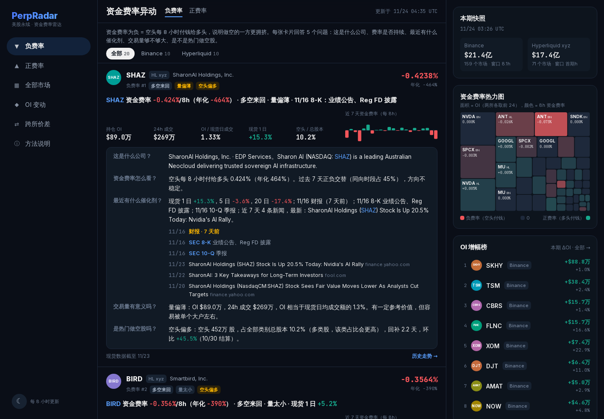
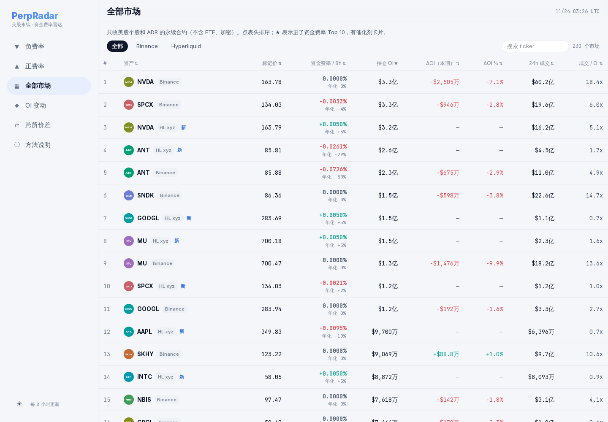

# perp-oi-funding-monitor

**Live dashboard → [stock-perp-radar.vercel.app](https://stock-perp-radar.vercel.app)**
(美股永续资金费率雷达，网站每小时更新，Telegram 报告每 8 小时)

A scanner and dashboard for **US stock perpetual futures** on **Binance USDT-M** and
**Hyperliquid** (HIP-3 dex `xyz`). Every hour it records open interest (OI) and funding
for each market and compares them with the run from 8 hours earlier (a rolling 8h
change). It publishes:

- **A Telegram report every 8 hours (00/08/16 UTC):** OI change for every ticker, OI gain/loss top 10, most negative
  and most positive funding top 10, and a cross-venue funding table.
- **A dashboard, refreshed every hour:** the same data, plus **catalyst cards** on two
  pages. **量有意义** (home) ranks funding only among markets with OI ≥ $1M and 24h volume
  ≥ $1M. **量没意义** ranks the rest separately. Each page shows a top 10 per venue and per
  funding sign, and each card answers five questions:
  1. **What is this company?** A Chinese and an English description, plus market cap,
     trailing four-quarter revenue and gross margin.
  2. **Is the funding skew persistent or a one-off spike?** Based on 7 days of the
     venue's own settled funding, in 8h buckets.
  3. **What are the recent catalysts?** The next earnings date with its weekday and
     pre-market/after-hours timing (or an estimate marked unconfirmed), last quarter's EPS
     against consensus, SEC 8-K items, offerings and periodic reports, relevant news, and
     spot moves over 1, 5 and 20 days.
  4. **Is the perp volume meaningful?** OI, 24h volume, and OI as a share of the
     stock's average daily dollar volume.
  5. **Is it a crowded short?** FINRA short interest as a share of shares outstanding,
     days to cover, and the change.



<details>
<summary>Dark theme and the all-markets table</summary>




</details>

It only collects public data: no API keys, no orders. Every catalyst source (Nasdaq,
Yahoo Finance RSS, SEC EDGAR, FINRA, Binance, Hyperliquid) is public and keyless.

> **Not investment advice.** This repo organizes public market data. Catalyst cards list
> facts next to each other; they do not claim cause and effect.

## How it works

```
cron, every hour (non-US host)
  ├─ perp-monitor run    Binance + Hyperliquid -> SQLite -> reports/latest.*
  │                      at 00/08/16 UTC also: dated report copy + Telegram + git push
  ├─ perp-monitor site   latest report + 14-day history + catalyst cards -> web/data/*.json
  └─ deploy_site.sh      vercel build + deploy --prebuilt -> dashboard (no git commit)
```

## Quick start

```bash
uv venv .venv --python 3.12
uv pip install --python .venv/bin/python -e ".[dev]"
cp .env.example .env          # optional: Telegram, paths, window settings
./run.sh --no-store           # dry run: print a live report, write and store nothing
./run.sh --manual             # full ad-hoc cycle: report files + SQLite + Telegram
```

Each run writes `reports/YYYY-MM-DD/HHMMZ.md` (human report), `HHMMZ.json` (same data for
a dashboard), and refreshes `reports/latest.md` / `latest.json`.

## Schedule

Runs from **this server's crontab** every hour (`scheduler/crontab.example`):

```
0 * * * * /path/to/perp-oi-funding-monitor/scheduler/run_and_push.sh
```

`scheduler/run_and_push.sh` appends its own log to `logs/cron.log` and takes a lock, so
overlapping runs (including a manual `./run.sh`) are skipped. It has two modes, picked by
the UTC hour (force one with `--report` or `--hourly`):

| Mode | When | What it does |
|---|---|---|
| report | 00, 08, 16 UTC | full cycle: Telegram, dated report copy, then commit and push `reports/` |
| hourly | every other hour | `run --no-notify --no-archive`: stores the snapshot and refreshes `reports/latest.*` only |

Both modes then run `perp-monitor site` and `scheduler/deploy_site.sh`, which builds the
dashboard on this server and deploys the build output to Vercel (`vercel deploy
--prebuilt`). Hourly data is therefore never committed, and git-triggered Vercel builds
are off (`web/vercel.json`). If a git push fails, the commits stay local and the next
report run pushes them.

Each run compares with the latest stored run at least 7h45m old, which is the run from
8 hours earlier when runs are hourly. All OI changes are therefore rolling 8-hour changes.

**Why not a GitHub Actions cron?** Binance answers US IP addresses with HTTP 451, and
GitHub's hosted runners are mostly in the US. GitHub Actions only runs lint and tests
(`.github/workflows/test.yml`).

Exit codes:

| Code | Meaning |
|---|---|
| `0` | ok |
| `1` | a venue or Telegram failed; the rest of the report still goes out |
| `2` | aborted (bad config, the crypto check fired, or a crash); nothing is stored and a Telegram alert is sent |
| `3` | another run holds the lock |
| `4` | git commit or push failed; retried next run |
| `5` | the dashboard deploy failed; the site keeps the previous deployment |

If every venue fails, nothing is stored, `latest.*` is left as it was, and Telegram gets an
alert instead of a report.

## Keeping crypto out

The hard rule is that no crypto perp may appear in any report. Several stock tickers are
also crypto perps: on Binance, `BB`, `CVX`, `QNT` and `STX` are crypto, and `CAT` is close
to `1000CAT`. On Hyperliquid xyz, `CL` is crude oil and `GOLD` is gold. Matching on names
would mix these up, so there are four layers:

| Layer | Where | Rule |
|---|---|---|
| Venue market type | `binance_client.select_equity_symbols`, `hyperliquid_client` | Binance: `underlyingType=EQUITY`, `contractType=TRADIFI_PERPETUAL`, USDT, `TRADING`. Hyperliquid: only the HIP-3 dexes named in `HL_DEXES`. The main (crypto) dex is never read. |
| Venue overrides | `assets/symbol_overrides.toml` | Aliases (`BRKB` → `BRK.B`) and per-venue exclusions (`CL`, `GOLD`, `SILVER` on Hyperliquid) |
| Allowlist | `assets/stocks_allowlist.txt` | The canonical ticker must be listed |
| Final check | `guard.py` | Every row must come from `binance:EQUITY` or `hl:<dex>`, and no table row may contain a symbol from `assets/crypto_denylist.txt`. Otherwise the run aborts before anything is stored or sent. |

## Allowlist maintenance

`assets/stocks_allowlist.txt` holds one ticker per line: US-listed single stocks and ADRs.
It excludes ETFs, leveraged ETFs, preferreds, and non-US stocks. The file header records
its source and every deliberate exclusion.

```bash
.venv/bin/perp-monitor allowlist suggest           # venue stock perps not on the list yet
.venv/bin/perp-monitor allowlist validate --sec    # format, duplicates, denylist, SEC listing check
.venv/bin/perp-monitor allowlist add PLTR CRWD
.venv/bin/perp-monitor allowlist remove XYZ
```

`suggest` lists everything a venue calls a stock that the allowlist doesn't have yet.
Review each name before adding it: many are ETFs (QQQ, SOXL…) or non-US. `--sec` checks
each ticker against SEC's `company_tickers_exchange.json`. That file covers operating
companies and ADRs but not most ETFs, so a miss is a warning to review, not an error.
Set `SEC_USER_AGENT` to your own contact string.

## How the numbers are computed

| Metric | Definition |
|---|---|
| OI (USD) | contracts × mark price (Binance `premiumIndex.markPrice`, Hyperliquid `markPx`) |
| ΔOI | current OI USD − previous OI USD. Rankings use this. |
| Δ contracts % | change in contracts, which removes the effect of the price move |
| Funding 8h | converted to 8h. Hyperliquid: the market's current hourly `funding` × 8. Binance: `premiumIndex.lastFundingRate`, using each symbol's interval from `/fapi/v1/fundingInfo` (8h unless listed). Rankings use this. |
| APR | funding × periods per year, simple (not compounded) |
| Window | actual time since the previous observation, flagged if outside `EXPECTED_WINDOW_HOURS ± WINDOW_TOLERANCE_HOURS` |
| Previous observation | the latest stored run at least `EXPECTED − min(TOLERANCE, 15 min)` old (7h45m by default). With hourly runs that is the run from 8h earlier, and a manual run just before a scheduled one does not shrink its window. If no run is that old (the first 8h of data), Binance uses its own OI history at now − 8h, and Hyperliquid uses the oldest stored run, which is the widest window available. The window is flagged when it is not about 8h. |

Edge cases:
- **First run.** Binance's previous OI is backfilled from `/futures/data/openInterestHist`, so 8h changes show at once. Hyperliquid has no OI history endpoint, so its OI rankings start at the second run.
- **Listing changes.** Markets seen for the first time are marked `new` and left out of OI rankings. Delisted markets disappear.
- **Zero funding.** Funding of exactly 0 (common on Binance stock perps) is left out of the funding rankings, so a list can have fewer than 10 rows, and the report says so.

## Layout

```
src/perp_monitor/
  models.py              frozen+slots dataclasses (MarketSnapshot, PriorPoint, MarketChange, Window)
  config.py              env vars -> Config
  http.py                JSON over HTTP with bounded retries
  allowlist.py           allowlist load/validate/edit/suggest
  overrides.py           venue aliases and exclusions
  binance_client.py      Binance stock perps + OI history
  hyperliquid_client.py  Hyperliquid HIP-3 dex markets
  funding.py             8h / APR normalization
  store.py               SQLite snapshots
  delta.py, ranking.py   changes vs previous run, top-N
  report.py              report model
  render_md.py / render_tg.py / render_json.py
  guard.py               stock-only checks
  notify.py              Telegram sender (token redacted from errors)
  sec.py                 SEC listing lookup for allowlist validation
  pipeline.py            one full cycle
  site_export.py         web/data/*.json for the dashboard
  cli.py                 `perp-monitor run|site|allowlist ...`
  insights/              catalyst cards: sources (nasdaq, news, sec_filings, finra,
                         funding_history), rules (analysis), text (narrative),
                         orchestration (collect, live_source), cache, serialize
web/                     Next.js dashboard (reads web/data/*.json)
```

## Tests

```bash
.venv/bin/python -m pytest --cov                   # deterministic tests (recorded real API responses)
RUN_LIVE=1 .venv/bin/python -m pytest tests/live   # real Binance + Hyperliquid calls (non-US host)
.venv/bin/ruff check . && .venv/bin/ruff format --check .
```

`tests/fixtures/` holds real API responses recorded on 2026-11-24, trimmed to a few
markets. They include the crypto name collisions.

## Telegram

Set `TELEGRAM_CHAT_ID`, plus either `TELEGRAM_BOT_TOKEN` or `TELEGRAM_TOKEN_FILE` (a dotenv
file containing `TELEGRAM_BOT_TOKEN=`), in `.env`. Each run sends one message per venue
and a cross-venue message, then the full report as a `.md` document. The token is never
logged: httpx request logging is turned down and errors redact it.

## Adding a Hyperliquid dex

`HL_DEXES` accepts any HIP-3 dex that exists. The allowlist still applies, so a
non-stock dex can only leak a market whose name equals an allowlisted ticker. Check a
new dex's market list before adding it. As of 2026-11, `io` and `para` also list some
stocks, but `para` is mostly crypto indices and rates.

## Dashboard

`web/` is a Next.js 16 app (App Router, Tailwind 4). It reads `web/data/*.json` at build
time, so every page is static. The Vercel project's Root Directory is `web`. `web/data/`
is generated and git-ignored: run `perp-monitor site` before building.

```bash
.venv/bin/perp-monitor site                  # write web/data: report, history, insights, meta
.venv/bin/perp-monitor site --skip-insights  # same, but keep the previous insights.json
cd web && npm install && npm run dev         # local preview on :3000
./scheduler/deploy_site.sh                   # build here and deploy to Vercel production
```

`deploy_site.sh` needs a logged-in Vercel CLI and a linked project (`vercel link`, which
writes the git-ignored `.vercel/project.json`). It uploads the build as one `--archive=tgz`
file. Without that, each deploy uploads about 1,300 changed files, and the Hobby plan
allows 5,000 file uploads a day (`api-upload-free`). An hourly deploy is 24 of the 100
deployments a day the plan allows.

| File | Content |
|---|---|
| `report.json` | copy of `reports/latest.json` |
| `history.json` | last 14 days of runs from SQLite: per market `[run, funding_8h, oi_usd, price, volume]` |
| `insights.json` | one card per ticker in each venue's funding top 10 (below) |
| `meta.json` | build time, and `insights_error` if the cards could not be refreshed |

### Catalyst cards

Each card answers five questions in Chinese: what the company is, whether the funding
skew is persistent, recent catalysts, whether the perp volume means anything, and whether
the stock is a crowded short. Sources, all public and keyless:

| Data | Source | Cache |
|---|---|---|
| Company profile, market cap and shares | Nasdaq `api.nasdaq.com` (`/company/{s}/company-profile`, `/quote/{s}/summary`, `/quote/{s}/info`) | 30 days / 3 days, company DB |
| Daily bars (returns, 20-session dollar volume) | Nasdaq `/quote/{s}/historical` | none |
| Earnings dates (−7 to +35 days, with pre-market/after-hours) | Nasdaq `/calendar/earnings?date=` | 6 h per day |
| Last earnings (EPS vs consensus); next-date estimate = last report + 91 days when the calendar has no date | Nasdaq `/company/{s}/earnings-surprise` | 1 day, company DB |
| TTM revenue and gross profit (sum of the latest 4 quarters, in thousands × 1000) | Nasdaq `/company/{s}/financials?frequency=2` | 7 days, company DB |
| Chinese name and description | `assets/company_zh.json`, curated in the repo | — |
| News (last 7 days) | Yahoo Finance RSS, kept only if the headline or summary names the ticker or company | none |
| Filings (last 14 days): 8-K items, 424B offerings, 10-Q/K, 6-K | SEC `data.sec.gov/submissions` | CIK map 7 days |
| Short interest | FINRA consolidated short interest (twice monthly) | 12 h |
| 7-day funding history | Binance `/fapi/v1/fundingRate`, Hyperliquid `fundingHistory` | none |

Company facts live in a local SQLite database, `data/companies.db` (git-ignored), with one
timestamp per group of columns, so a profile is fetched monthly and financials weekly, not
on every hourly run. Funds and foreign filers that Nasdaq has no statements for are stored
as known-missing, so they are not refetched every hour either.

```bash
.venv/bin/perp-monitor companies status         # coverage: Chinese entries, profiles, financials
.venv/bin/perp-monitor companies refresh        # fill stale entries for the whole allowlist
.venv/bin/perp-monitor companies refresh NVDA   # or for some tickers
sqlite3 data/companies.db "select ticker, name, market_cap_usd, revenue_ttm_usd from companies"
```

`assets/company_zh.json` holds a Chinese name and a one-line description per allowlisted
ticker (a test checks coverage). An entry can also carry `en` to replace a wrong English
description from the source. Add an entry whenever a ticker joins the allowlist.

Short-lived API results (CIK map, earnings calendar days, FINRA) are cached in
`data/cache/insights.json` (git-ignored). A failed source is recorded
on the card (`errors`) and the card is still built. If the whole step fails, the previous
`insights.json` is kept and the site shows a notice.

Rules (constants in `src/perp_monitor/insights/analysis.py`, shown on the site's
方法说明 page):

| Question | Rule |
|---|---|
| Volume meaningful? | noise: OI < $250K or 24h volume < $100K; meaningful: OI ≥ $1M and volume ≥ $1M; otherwise thin. Meaningful markets go on the 量有意义 page (`bucket: liquid`), thin and noise on 量没意义 (`illiquid`), and each page has its own top 10. |
| Funding persistent? | share of 8h buckets in the last 7 days with the current sign: ≥ 60% persistent, ≤ 25% spike, else mixed; < 3 buckets: insufficient |
| Crowded short? | short shares ÷ shares outstanding (market cap ÷ close): ≥ 15% high, ≥ 8% elevated, ≥ 4% moderate; a lower share with ≥ 7 days to cover also counts as moderate |
